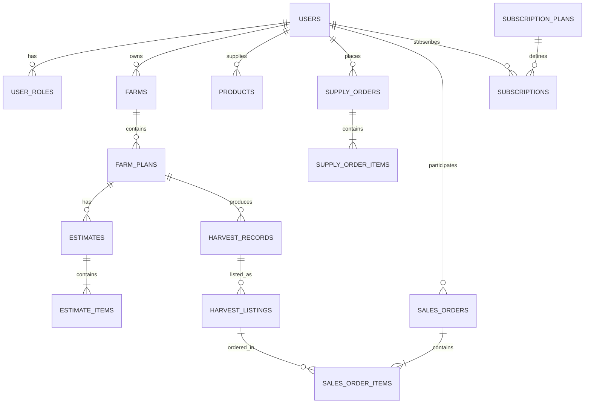

# Product Requirements Document (PRD) — AgriLink

**Versi:** 1.0 — Draft untuk validasi produk  
**Platform:** Web responsif desktop dan mobile  
**Target pengguna utama:** Petani  
**Model bisnis:** Langganan premium  
**Status teknologi:** Belum ditentukan

## Ringkasan Produk

AgriLink adalah platform digital terintegrasi yang menghubungkan perencanaan lahan, estimasi kebutuhan dan modal, pengadaan kebutuhan pertanian, pencatatan hasil panen, serta penjualan hasil pertanian dalam satu sistem.

Fokus utama MVP adalah **petani**, dengan tujuan membantu petani mengelola aktivitas pertanian secara lebih terstruktur, sejak tahap perencanaan sampai hasil panen dijual.

| Aspek | Keputusan |
|---|---|
| Target pengguna utama | Petani |
| Pengguna lain | Supplier, buyer, admin |
| Platform | Web responsif desktop dan mobile |
| Fitur MVP | Kelima fitur utama AgriLink |
| Model bisnis | Langganan premium |
| Definisi selesai | Alur utama dari perencanaan hingga transaksi penjualan hasil panen dapat berjalan end-to-end |
| Teknologi | Belum ditentukan |
| Status dokumen | Draft untuk validasi requirement |

**Prinsip produk:** seluruh fitur harus saling terhubung. Data perencanaan dapat menjadi dasar estimasi kebutuhan dan modal, aktivitas pertanian dapat dicatat, hasil panen dapat direkam, dan hasil tersebut dapat ditawarkan melalui marketplace.

Keterhubungan ini merupakan sasaran desain produk. Detail otomatisasi, integrasi data, pembayaran, pengiriman, dan aturan bisnis masih perlu divalidasi.

## 1. Problem Statement — Masalah yang Diselesaikan

### 1.1 Masalah utama

Aktivitas pertanian terdiri atas beberapa proses yang saling berkaitan, tetapi pengelolaannya berpotensi terpisah antara perencanaan lahan, perhitungan kebutuhan dan modal, pembelian sarana produksi, pencatatan hasil panen, dan penjualan hasil pertanian.

Kondisi tersebut dapat menyebabkan petani kesulitan memperoleh gambaran menyeluruh mengenai kegiatan pertanian dan hasil usahanya.

### 1.2 Pihak yang terdampak

**Petani — pengguna utama**

Kesulitan yang perlu divalidasi:
- Menyusun rencana penggunaan lahan dan kebutuhan produksi.
- Menghitung perkiraan kebutuhan serta modal sebelum memulai kegiatan.
- Melacak pengeluaran dan hasil panen dalam satu catatan.
- Menemukan saluran penjualan hasil pertanian.

**Supplier — pengguna pendukung**

Berpotensi mengalami kesulitan menjangkau petani dan mengelola informasi produk, harga, serta pesanan melalui saluran yang terintegrasi.

**Buyer — pengguna pendukung**

Berpotensi kesulitan menemukan hasil pertanian yang sesuai dengan komoditas, jumlah, lokasi, dan kebutuhan pembelian.

Masalah supplier dan buyer di atas merupakan hipotesis awal, bukan hasil riset pengguna yang sudah terkonfirmasi.

### 1.3 Problem statement utama

> Petani membutuhkan satu sistem terintegrasi untuk merencanakan kegiatan pertanian, memperkirakan kebutuhan dan modal, mencatat pelaksanaan serta hasil panen, dan memasarkan hasil pertanian tanpa harus mengelola setiap proses secara terpisah.

### 1.4 Dampak yang diharapkan

- Perencanaan kegiatan pertanian lebih terstruktur.
- Estimasi kebutuhan dan modal tersedia sebelum pengadaan.
- Data pengeluaran dan hasil panen terdokumentasi.
- Hasil panen dapat ditawarkan kepada calon pembeli.
- Petani memperoleh gambaran yang lebih baik tentang hasil usaha berdasarkan data yang tercatat.

Dampak tersebut adalah hipotesis manfaat produk yang perlu diuji melalui penggunaan MVP.

## 2. Target User dan Persona

### 2.1 Segmentasi pengguna

| Peran | Tanggung jawab utama |
|---|---|
| Petani | Merencanakan lahan, menghitung kebutuhan, mencatat panen, dan menjual hasil pertanian |
| Supplier | Mengelola katalog kebutuhan pertanian dan memproses pesanan |
| Buyer | Menemukan dan membeli hasil pertanian |
| Admin | Mengelola akun, mengawasi aktivitas, dan menangani masalah sistem |

Satu akun pengguna dapat mengaktifkan peran petani, supplier, atau buyer sesuai kebutuhan. Admin menggunakan akun dengan kewenangan khusus. Mekanisme pengaktifan beberapa peran sekaligus perlu ditetapkan sebelum implementasi.

### 2.2 Persona 1 — Petani yang mengelola kegiatan produksi

**Nama:** Pak Budi  
**Jenis persona:** Hipotetis — Petani  
**Karakteristik:** Mengelola lahan dan aktivitas produksi pertanian.

**Kebutuhan:**
- Merencanakan komoditas dan luas lahan.
- Mengestimasi kebutuhan sarana produksi dan modal.
- Mengetahui pengeluaran serta hasil panen.
- Menawarkan hasil panen kepada pembeli.

**Pain points yang perlu divalidasi:**
- Perencanaan dan pencatatan berpotensi tersebar di beberapa media.
- Perkiraan biaya belum tentu terdokumentasi secara konsisten.
- Informasi hasil panen tidak selalu terhubung dengan proses penjualan.

**Tujuan menggunakan AgriLink:** mengelola kegiatan pertanian dalam satu alur dan memanfaatkan catatan panen untuk penjualan.

### 2.3 Persona 2 — Petani yang merangkap penjual hasil panen

**Nama:** Ibu Sari  
**Jenis persona:** Hipotetis — Petani dan penjual  
**Karakteristik:** Mengelola hasil produksi dan ingin menjual hasil panen melalui kanal digital.

**Kebutuhan:**
- Mencatat jumlah dan kualitas hasil panen.
- Menentukan jumlah hasil panen yang tersedia untuk dijual.
- Membuat penawaran produk pertanian.
- Memantau pesanan dan status penjualan.

**Pain points yang perlu divalidasi:**
- Data panen dan informasi penjualan dapat tercatat secara terpisah.
- Ketersediaan produk mungkin tidak diperbarui setelah terjadi penjualan.
- Status pesanan dan penyelesaian transaksi mungkin sulit dipantau.

**Tujuan menggunakan AgriLink:** mengubah catatan hasil panen menjadi penawaran yang dapat dibeli dan melacak proses penjualannya.

Kedua persona merupakan representasi awal untuk merancang produk, bukan profil responden berdasarkan wawancara atau survei aktual.

## 3. Goals dan Non-goals

### 3.1 Product goals

| ID | Goal | Indikator keberhasilan |
|---|---|---|
| G-01 | Memfasilitasi perencanaan lahan | Petani dapat membuat dan menyimpan rencana lahan |
| G-02 | Membantu estimasi kebutuhan dan modal | Petani memperoleh rincian kebutuhan serta total estimasi biaya |
| G-03 | Memfasilitasi pengadaan kebutuhan pertanian | Petani dapat mencari produk supplier dan membuat pesanan |
| G-04 | Mendokumentasikan hasil panen | Petani dapat mencatat dan melihat riwayat panen |
| G-05 | Memfasilitasi penjualan hasil pertanian | Hasil panen dapat ditawarkan dan dipesan buyer |
| G-06 | Menghubungkan proses pertanian | Data terkait lahan, estimasi, panen, dan penjualan saling terhubung sesuai aturan bisnis |
| G-07 | Menyediakan model langganan premium | Sistem memiliki mekanisme paket premium setelah aturan paket disepakati |
| G-08 | Menyediakan pengelolaan sistem | Admin dapat mengawasi pengguna dan aktivitas yang diperlukan |

### 3.2 Non-goals MVP

Hal-hal berikut tidak menjadi sasaran MVP kecuali nantinya diputuskan sebagai requirement tambahan:

- Prediksi hasil panen berbasis AI atau machine learning.
- Rekomendasi komoditas otomatis berdasarkan cuaca, tanah, atau kondisi pasar.
- Integrasi sensor IoT, drone, atau perangkat pertanian pintar.
- Integrasi otomatis dengan layanan cuaca eksternal.
- Aplikasi native Android dan iOS.
- Integrasi langsung dengan bank, layanan pinjaman, atau pembiayaan pertanian.
- Sistem akuntansi lengkap dan perpajakan usaha.
- Pengelolaan rantai pasok tingkat perusahaan.
- Integrasi logistik pihak ketiga secara otomatis.
- Penentuan harga jual otomatis berbasis harga pasar.

Non-goals tersebut merupakan batas awal scope, bukan pernyataan bahwa fitur-fitur tersebut tidak akan pernah dikembangkan.

## 4. User Stories

### 4.1 Petani

- **US-01:** Sebagai petani, saya ingin membuat profil lahan supaya saya dapat mengelola informasi lahan secara terstruktur.
- **US-02:** Sebagai petani, saya ingin membuat rencana penanaman supaya saya dapat merencanakan kegiatan produksi.
- **US-03:** Sebagai petani, saya ingin mencatat komoditas, luas lahan, dan jadwal kegiatan supaya rencana dapat ditinjau kembali.
- **US-04:** Sebagai petani, saya ingin memperoleh estimasi kebutuhan pertanian supaya saya dapat mempersiapkan sarana produksi.
- **US-05:** Sebagai petani, saya ingin menghitung estimasi modal supaya saya dapat mengetahui perkiraan biaya sebelum memulai kegiatan.
- **US-06:** Sebagai petani, saya ingin mencari produk kebutuhan pertanian supaya saya dapat memilih produk yang sesuai.
- **US-07:** Sebagai petani, saya ingin membuat pesanan kepada supplier supaya pengadaan kebutuhan dapat dilakukan melalui AgriLink.
- **US-08:** Sebagai petani, saya ingin mencatat hasil panen supaya data produksi tersimpan dan dapat ditinjau kembali.
- **US-09:** Sebagai petani, saya ingin menawarkan hasil panen di marketplace supaya calon pembeli dapat menemukan produk saya.
- **US-10:** Sebagai petani, saya ingin melihat status pesanan dan penjualan supaya saya dapat mengetahui perkembangan transaksi.

### 4.2 Supplier

- **US-11:** Sebagai supplier, saya ingin mengelola katalog produk supaya petani dapat menemukan kebutuhan pertanian yang saya jual.
- **US-12:** Sebagai supplier, saya ingin memperbarui harga dan stok supaya informasi produk tetap sesuai dengan ketersediaan.
- **US-13:** Sebagai supplier, saya ingin melihat dan memperbarui status pesanan supaya saya dapat mengelola pemenuhan pesanan.

### 4.3 Buyer

- **US-14:** Sebagai buyer, saya ingin mencari hasil pertanian berdasarkan informasi produk supaya saya dapat menemukan komoditas yang dibutuhkan.
- **US-15:** Sebagai buyer, saya ingin melihat rincian penawaran supaya saya dapat mengevaluasi produk sebelum memesan.
- **US-16:** Sebagai buyer, saya ingin membuat pesanan hasil pertanian supaya saya dapat membeli produk dari petani.
- **US-17:** Sebagai buyer, saya ingin melihat status pesanan supaya saya mengetahui perkembangan pembelian.

### 4.4 Admin

- **US-18:** Sebagai admin, saya ingin mengelola akun pengguna supaya akses terhadap sistem dapat dikendalikan.
- **US-19:** Sebagai admin, saya ingin meninjau produk dan penawaran yang dilaporkan supaya konten bermasalah dapat ditangani.
- **US-20:** Sebagai admin, saya ingin melihat ringkasan aktivitas transaksi supaya saya dapat mengawasi penggunaan sistem.
- **US-21:** Sebagai admin, saya ingin mengelola konfigurasi paket langganan supaya penawaran premium dapat diatur sesuai kebijakan bisnis.

## 5. Daftar Fitur: MVP, V2, dan Nanti

Pembagian berikut adalah rekomendasi roadmap awal. Seluruh fitur utama yang dipilih tetap masuk MVP, tetapi fitur pendukung merupakan usulan yang perlu dikonfirmasi.

### MVP — versi pertama

**Target:** alur inti berfungsi dari perencanaan hingga transaksi penjualan hasil panen.

- Registrasi, login, profil, dan pengaturan peran pengguna.
- Pengelolaan profil lahan dan rencana pertanian.
- Estimasi kebutuhan dan modal berdasarkan data yang diinput.
- Marketplace kebutuhan pertanian dan pemesanan kepada supplier.
- Pencatatan hasil panen.
- Marketplace penjualan hasil pertanian.
- Pemesanan hasil pertanian oleh buyer.
- Pengelolaan status pesanan dan transaksi.
- Dashboard dan riwayat aktivitas utama.
- Pengelolaan akun, moderasi, dan pengawasan dasar oleh admin.
- Fondasi paket premium, dengan aturan akses menunggu keputusan bisnis.

### V2 — peningkatan pengalaman

- Notifikasi aktivitas, jadwal, dan perubahan status pesanan.
- Riwayat biaya aktual dibandingkan estimasi modal.
- Laporan hasil produksi dan penjualan yang lebih terperinci.
- Ulasan dan reputasi supplier serta buyer.
- Filter pencarian berdasarkan lokasi dan ketersediaan.
- Pengelolaan langganan premium yang lebih lengkap.
- Ekspor laporan ke PDF atau spreadsheet.

### Nanti — pengembangan lanjutan

- Prediksi hasil panen dan rekomendasi berbasis AI.
- Integrasi cuaca dan informasi harga pasar.
- Rekomendasi kebutuhan pertanian berdasarkan komoditas dan luas lahan.
- Integrasi logistik dan pelacakan pengiriman.
- Integrasi pembayaran digital dan rekonsiliasi otomatis.
- Integrasi IoT dan pemantauan kondisi lahan.
- Analisis profitabilitas usaha pertanian lintas musim.

**Catatan scope:** fitur pesanan dan status transaksi masuk MVP karena definisi selesai mengharuskan alur penjualan end-to-end. Pembayaran digital, pengiriman otomatis, dan integrasi pihak ketiga belum otomatis menjadi bagian MVP.

## 6. Functional Requirements Detail per Fitur MVP

Prioritas: **P0** = wajib agar alur utama dapat berjalan; **P1** = penting untuk operasional MVP. Prioritas ini merupakan usulan awal.

### 6.1 Autentikasi dan pengelolaan peran

| ID | Requirement | Prioritas |
|---|---|---|
| AUTH-01 | Sistem menyediakan registrasi dan login pengguna. | P0 |
| AUTH-02 | Pengguna dapat melengkapi dan memperbarui profil. | P0 |
| AUTH-03 | Pengguna dapat mengaktifkan peran petani, supplier, atau buyer sesuai mekanisme yang ditetapkan. | P0 |
| AUTH-04 | Sistem membatasi akses berdasarkan peran dan kepemilikan data. | P0 |
| AUTH-05 | Admin memiliki hak akses administratif yang terpisah dari pengguna biasa. | P0 |
| AUTH-06 | Sistem memvalidasi input serta menangani sesi autentikasi yang tidak valid atau kedaluwarsa. | P0 |

**Acceptance criteria:**
- Pengguna yang belum login tidak dapat mengakses halaman privat.
- Pengguna tidak dapat mengubah data milik pengguna lain tanpa kewenangan.
- Peran aktif menentukan menu dan tindakan yang dapat dilakukan.
- Akun admin tidak dapat diperoleh hanya dengan memilih peran saat registrasi.

### 6.2 Perencanaan lahan pertanian

| ID | Requirement | Prioritas |
|---|---|---|
| LAND-01 | Petani dapat membuat, melihat, mengubah, dan mengarsipkan profil lahan. | P0 |
| LAND-02 | Profil lahan menyimpan identitas lahan, luas, lokasi atau keterangan lokasi, serta status. | P0 |
| LAND-03 | Petani dapat membuat rencana pertanian untuk lahan yang dimiliki atau dikelolanya. | P0 |
| LAND-04 | Rencana menyimpan komoditas, luas yang digunakan, tanggal atau periode rencana, dan status. | P0 |
| LAND-05 | Sistem memvalidasi luas dan tanggal sesuai aturan yang disepakati. | P0 |
| LAND-06 | Petani dapat melihat daftar rencana beserta detail dan statusnya. | P0 |
| LAND-07 | Rencana yang telah digunakan dalam pencatatan atau transaksi harus dipertahankan integritas datanya saat diarsipkan. | P0 |

**Acceptance criteria:**
- Petani dapat menyimpan rencana dan membukanya kembali.
- Luas rencana tidak boleh melebihi luas lahan yang tersedia apabila aturan penggunaan lahan ditetapkan sebagai pembatas.
- Data wajib yang kosong atau tidak valid menghasilkan pesan kesalahan yang jelas.
- Pengarsipan tidak menghapus riwayat panen dan transaksi terkait.

**Belum ditentukan:** apakah satu lahan dapat memiliki beberapa rencana aktif sekaligus, apakah rotasi tanaman didukung, dan apakah lokasi harus menggunakan koordinat peta.

### 6.3 Estimasi kebutuhan dan modal pertanian

| ID | Requirement | Prioritas |
|---|---|---|
| EST-01 | Petani dapat membuat estimasi dari rencana pertanian yang tersedia. | P0 |
| EST-02 | Petani dapat memasukkan daftar kebutuhan pertanian, satuan, jumlah, dan harga satuan estimasi. | P0 |
| EST-03 | Sistem menghitung subtotal setiap kebutuhan berdasarkan jumlah dan harga satuan. | P0 |
| EST-04 | Sistem menjumlahkan subtotal untuk menghasilkan total estimasi modal. | P0 |
| EST-05 | Petani dapat mengubah dan menyimpan estimasi selama belum dikunci oleh proses lain. | P0 |
| EST-06 | Sistem menyimpan riwayat estimasi dan membedakan data estimasi dari pengeluaran aktual. | P0 |
| EST-07 | Sistem dapat menghubungkan item estimasi dengan produk marketplace apabila produk yang sesuai tersedia. | P1 |

**Aturan perhitungan awal:**

`Subtotal_i = Jumlah_i × Harga Satuan_i`

`Total Estimasi = Σ Subtotal_i`

Rumus tersebut merupakan perhitungan dasar. Pajak, biaya transportasi, tenaga kerja, penyusutan, biaya tak terduga, dan komponen lain belum ditetapkan.

**Acceptance criteria:**
- Total dihitung ulang ketika jumlah atau harga satuan berubah.
- Sistem menolak jumlah negatif dan harga yang tidak valid.
- Estimasi tetap dapat dilihat setelah disimpan.
- Perubahan harga katalog tidak boleh diam-diam mengubah estimasi lama yang sudah tersimpan.

**Belum ditentukan:** apakah sistem menyediakan template kebutuhan per komoditas atau seluruh item harus dimasukkan secara manual.

### 6.4 Marketplace kebutuhan pertanian

| ID | Requirement | Prioritas |
|---|---|---|
| SUP-01 | Supplier dapat membuat dan mengelola listing produk. | P0 |
| SUP-02 | Listing memuat nama, kategori, deskripsi, harga, satuan penjualan, dan stok. | P0 |
| SUP-03 | Petani dapat melihat serta mencari produk yang aktif. | P0 |
| SUP-04 | Petani dapat melihat detail produk dan informasi supplier. | P0 |
| SUP-05 | Petani dapat membuat pesanan dengan kuantitas yang valid. | P0 |
| SUP-06 | Sistem memvalidasi ketersediaan stok ketika pesanan dibuat. | P0 |
| SUP-07 | Supplier dapat melihat pesanan yang ditujukan kepadanya dan memperbarui status sesuai alur yang diizinkan. | P0 |
| SUP-08 | Sistem menyimpan rincian item dan harga pada saat pemesanan. | P0 |
| SUP-09 | Sistem mencegah perubahan listing yang merusak riwayat pesanan lama. | P0 |

**Acceptance criteria:**
- Produk nonaktif tidak dapat dipesan.
- Pesanan tidak boleh melebihi stok yang tersedia.
- Harga pada pesanan tersimpan sebagai snapshot agar perubahan harga berikutnya tidak mengubah pesanan lama.
- Perubahan status pesanan hanya dapat dilakukan oleh pihak yang berwenang.
- Dua pesanan bersamaan tidak boleh menyebabkan stok terjual melebihi ketersediaan.

**Belum ditentukan:** metode pembayaran, mekanisme pengiriman, pembatalan, pengembalian dana, dan siapa yang bertanggung jawab atas pemenuhan pesanan.

### 6.5 Pencatatan hasil panen

| ID | Requirement | Prioritas |
|---|---|---|
| HAR-01 | Petani dapat membuat catatan panen yang terkait dengan lahan atau rencana pertanian. | P0 |
| HAR-02 | Catatan menyimpan komoditas, tanggal panen, jumlah, dan satuan. | P0 |
| HAR-03 | Petani dapat menambahkan informasi kualitas atau catatan tambahan. | P1 |
| HAR-04 | Petani dapat melihat riwayat hasil panen. | P0 |
| HAR-05 | Petani dapat mengubah catatan sesuai kebijakan penguncian data. | P0 |
| HAR-06 | Sistem melacak jumlah hasil panen yang sudah dialokasikan atau terjual jika mekanisme stok panen digunakan. | P0 |
| HAR-07 | Sistem mencegah jumlah penjualan melebihi kuantitas hasil panen yang tersedia. | P0 |

**Acceptance criteria:**
- Catatan panen dapat disimpan dan ditampilkan kembali.
- Jumlah harus positif dan satuan harus jelas.
- Data panen terhubung dengan petani pemilik dan, bila relevan, rencana pertanian.
- Koreksi data tidak boleh menghapus riwayat transaksi yang telah terjadi.
- Kuantitas yang tersedia untuk dijual harus dihitung berdasarkan aturan stok panen yang disepakati.

**Belum ditentukan:** apakah hasil panen perlu dibagi menjadi beberapa batch, apakah penyusutan atau produk rusak dicatat, dan apakah penjualan sebagian dari satu catatan panen didukung.

### 6.6 Marketplace penjualan hasil pertanian

| ID | Requirement | Prioritas |
|---|---|---|
| SALE-01 | Petani dapat membuat listing penjualan dari hasil panen yang tercatat. | P0 |
| SALE-02 | Listing memuat komoditas, kuantitas tersedia, satuan, harga, dan deskripsi. | P0 |
| SALE-03 | Buyer dapat mencari dan melihat listing yang aktif. | P0 |
| SALE-04 | Buyer dapat melihat detail produk dan informasi penjual. | P0 |
| SALE-05 | Buyer dapat membuat pesanan dengan jumlah yang valid. | P0 |
| SALE-06 | Sistem memvalidasi stok panen ketika pesanan dibuat. | P0 |
| SALE-07 | Petani dapat melihat pesanan dan memperbarui status sesuai kewenangan. | P0 |
| SALE-08 | Buyer dapat melihat rincian pesanan dan statusnya. | P0 |
| SALE-09 | Sistem menyimpan snapshot nama produk, harga, jumlah, dan total pesanan. | P0 |
| SALE-10 | Sistem menghubungkan pesanan dengan listing dan sumber hasil panen terkait. | P0 |

**Acceptance criteria:**
- Hanya listing aktif dengan kuantitas tersedia yang dapat dipesan.
- Sistem mencegah overselling saat beberapa buyer memesan bersamaan.
- Pesanan memiliki identitas unik dan status yang tercatat.
- Perubahan harga listing tidak mengubah nilai pesanan yang sudah dibuat.
- Listing diperbarui atau dinonaktifkan jika stok habis sesuai kebijakan yang ditentukan.
- Pesanan hanya dapat dinyatakan selesai berdasarkan aturan penyelesaian transaksi yang disepakati.

### 6.7 Admin dan pengawasan sistem

| ID | Requirement | Prioritas |
|---|---|---|
| ADM-01 | Admin dapat melihat daftar akun dan peran pengguna. | P0 |
| ADM-02 | Admin dapat menonaktifkan akun sesuai kewenangan dan kebijakan. | P0 |
| ADM-03 | Admin dapat meninjau listing kebutuhan pertanian dan hasil panen. | P0 |
| ADM-04 | Admin dapat menonaktifkan listing yang melanggar kebijakan. | P0 |
| ADM-05 | Admin dapat melihat ringkasan pesanan dan status transaksi. | P0 |
| ADM-06 | Sistem mencatat tindakan administratif yang penting. | P1 |
| ADM-07 | Admin dapat mengelola konfigurasi paket premium setelah ketentuan paket disepakati. | P1 |

**Acceptance criteria:**
- Pengguna biasa tidak dapat membuka fungsi administrasi.
- Penonaktifan listing tidak menghapus transaksi historis.
- Perubahan administratif yang berdampak besar dapat ditelusuri apabila audit log diterapkan.
- Admin tidak boleh mengubah rincian transaksi historis tanpa jejak perubahan.

### 6.8 Langganan premium

Model bisnis telah dipilih, tetapi hak akses paket belum ditentukan.

| ID | Requirement | Prioritas |
|---|---|---|
| SUB-01 | Sistem mendukung definisi paket langganan dan status langganan. | P1 |
| SUB-02 | Sistem dapat mengidentifikasi pengguna dengan langganan aktif, kedaluwarsa, atau belum berlangganan. | P1 |
| SUB-03 | Sistem menyediakan tempat untuk menerapkan pembatasan fitur berdasarkan paket. | P1 |
| SUB-04 | Sistem menyimpan periode aktif langganan dan riwayat perubahan status. | P1 |
| SUB-05 | Sistem memvalidasi status langganan sebelum memberikan akses ke fitur premium. | P1 |

**Keputusan yang masih diperlukan:**
- Fitur mana yang gratis dan mana yang premium.
- Harga, periode, dan batasan setiap paket.
- Apakah pembayaran langganan diproses di dalam platform.
- Apa yang terjadi pada data ketika langganan berakhir.

Jika pembayaran langganan belum tersedia dalam MVP, mekanisme aktivasi premium manual dapat dipertimbangkan sebagai solusi sementara, tetapi belum menjadi keputusan final.

### 6.9 Kebutuhan nonfungsional MVP

| Area | Requirement |
|---|---|
| Responsif | Antarmuka dapat digunakan pada layar desktop dan mobile. |
| Keamanan | Password disimpan menggunakan mekanisme hashing yang aman; akses data mengikuti otorisasi berbasis peran dan kepemilikan. |
| Integritas | Validasi stok dan pencatatan transaksi harus menjaga konsistensi ketika terdapat permintaan bersamaan. |
| Privasi | Data profil dan transaksi tidak boleh terlihat oleh pengguna yang tidak berwenang. |
| Kegunaan | Formulir memiliki label, validasi, pesan kesalahan, dan status proses yang jelas. |
| Keandalan | Kegagalan penyimpanan tidak boleh menampilkan status sukses palsu atau menghasilkan pesanan ganda tanpa penanganan. |
| Audit | Perubahan penting pada pesanan dan tindakan administratif dapat ditelusuri sesuai kebijakan. |
| Kompatibilitas | Browser dan versi minimum yang didukung perlu ditentukan. |

Target angka untuk performa, uptime, kapasitas pengguna, dan pemulihan data masih menjadi open questions.

## 7. Sketsa Data Model

Model data berikut merupakan rancangan awal berdasarkan kebutuhan fitur MVP, bukan skema database final. Nama tabel dan field dapat disesuaikan setelah teknologi dipilih.

**Keterangan:** PK = primary key; FK = foreign key.

### 7.1 Entitas dan field kunci

#### A. Pengguna dan akses

**`users`**
- `id` — PK
- `name`
- `email`
- `password_hash`
- `phone` — opsional
- `status`
- `created_at`, `updated_at`

**`user_roles`**
- `id` — PK
- `user_id` — FK → `users`
- `role` — farmer, supplier, buyer, atau admin
- `status`
- `created_at`

**`subscriptions`**
- `id` — PK
- `user_id` — FK → `users`
- `plan_id` — FK → `subscription_plans`
- `status`
- `start_at`, `end_at`

**`subscription_plans`**
- `id` — PK
- `name`
- `price`
- `billing_period`
- `features` atau konfigurasi hak akses
- `status`

#### B. Perencanaan dan estimasi

**`farms`**
- `id` — PK
- `owner_id` — FK → `users`
- `name`
- `location`
- `area_size`
- `area_unit`
- `status`

**`farm_plans`**
- `id` — PK
- `farm_id` — FK → `farms`
- `created_by` — FK → `users`
- `commodity`
- `planned_area`
- `start_date`
- `expected_harvest_date`
- `status`

**`estimates`**
- `id` — PK
- `farm_plan_id` — FK → `farm_plans`
- `created_by` — FK → `users`
- `total_estimated_cost`
- `status`
- `created_at`, `updated_at`

**`estimate_items`**
- `id` — PK
- `estimate_id` — FK → `estimates`
- `product_id` — FK opsional → `products`
- `item_name`
- `quantity`
- `unit`
- `estimated_unit_price`
- `subtotal`

#### C. Marketplace kebutuhan pertanian

**`products`**
- `id` — PK
- `supplier_id` — FK → `users`
- `name`
- `category`
- `description`
- `price`
- `unit`
- `stock`
- `status`

**`supply_orders`**
- `id` — PK
- `order_number`
- `buyer_id` — FK → `users`
- `supplier_id` — FK → `users`
- `subtotal`
- `shipping_cost` — opsional
- `total_amount`
- `status`
- `created_at`

**`supply_order_items`**
- `id` — PK
- `order_id` — FK → `supply_orders`
- `product_id` — FK → `products`
- `product_name_snapshot`
- `quantity`
- `unit_price_snapshot`
- `subtotal`

#### D. Hasil panen dan penjualan

**`harvest_records`**
- `id` — PK
- `farm_plan_id` — FK → `farm_plans`
- `farmer_id` — FK → `users`
- `commodity`
- `harvest_date`
- `quantity`
- `unit`
- `quality_notes` — opsional
- `status`

**`harvest_listings`**
- `id` — PK
- `harvest_record_id` — FK → `harvest_records`
- `seller_id` — FK → `users`
- `title`
- `description`
- `price_per_unit`
- `quantity_available`
- `unit`
- `status`

**`sales_orders`**
- `id` — PK
- `order_number`
- `buyer_id` — FK → `users`
- `seller_id` — FK → `users`
- `subtotal`
- `shipping_cost` — opsional
- `total_amount`
- `status`
- `created_at`

**`sales_order_items`**
- `id` — PK
- `order_id` — FK → `sales_orders`
- `listing_id` — FK → `harvest_listings`
- `product_name_snapshot`
- `quantity`
- `unit_price_snapshot`
- `subtotal`

#### E. Pengawasan dan transaksi

**`order_status_histories`**
- `id` — PK
- `order_type`
- `order_id`
- `previous_status`
- `new_status`
- `changed_by` — FK → `users`
- `created_at`

**`admin_audit_logs`**
- `id` — PK
- `admin_id` — FK → `users`
- `action`
- `entity_type`
- `entity_id`
- `created_at`

### 7.2 Relasi utama

### 7.3 Aturan integritas data

1. Setiap lahan memiliki pemilik yang teridentifikasi.
2. Rencana pertanian harus terkait dengan lahan yang dapat diakses oleh petani tersebut.
3. Item estimasi menyimpan harga pada saat estimasi dibuat.
4. Setiap listing hasil panen harus memiliki sumber panen yang valid.
5. Kuantitas yang dipesan tidak boleh melebihi stok yang tersedia.
6. Harga dan nama produk pada rincian pesanan harus disimpan sebagai snapshot.
7. Penghapusan atau pengarsipan data master tidak boleh merusak riwayat transaksi.
8. Perhitungan stok harus menangani pemesanan bersamaan melalui transaksi database atau mekanisme konsistensi yang setara.

**Catatan desain:** satu pesanan sebaiknya dibatasi pada satu supplier atau satu seller pada MVP agar pemenuhan pesanan lebih sederhana. Apabila keranjang multi-seller dibutuhkan, pemecahan pesanan dan pengelolaan statusnya perlu dirancang secara eksplisit.

## 8. Edge Case dan Failure State

| Skenario | Perilaku sistem yang diharapkan |
|---|---|
| Registrasi dengan email yang sudah terdaftar | Menolak registrasi dan memberikan pesan yang jelas. |
| Pengguna mencoba mengakses fitur tanpa peran yang sesuai | Menolak akses. |
| Petani memasukkan luas lahan nol atau negatif | Menolak input yang tidak valid. |
| Luas rencana melebihi luas lahan | Memberikan validasi jika aturan batas luas diterapkan. |
| Harga atau jumlah kebutuhan tidak valid | Menolak perhitungan dan menampilkan kesalahan. |
| Harga produk berubah setelah estimasi dibuat | Estimasi historis tetap menggunakan harga tersimpan. |
| Supplier mengubah harga saat buyer sedang memesan | Sistem memvalidasi harga terbaru sebelum konfirmasi dan menyimpan snapshot harga yang disetujui. |
| Stok habis sebelum pesanan dikonfirmasi | Pesanan ditolak atau diminta diperbarui; stok tidak boleh negatif. |
| Dua buyer memesan stok yang sama secara bersamaan | Hanya pesanan yang valid berdasarkan stok terkini yang berhasil memperoleh alokasi. |
| Catatan panen diubah setelah listing dibuat | Sistem menjaga konsistensi jumlah yang tersedia dan transaksi terkait. |
| Hasil panen sudah habis terjual | Listing tidak dapat menerima pesanan tambahan. |
| Buyer membatalkan pesanan | Sistem mengikuti aturan pembatalan dan pengembalian stok yang telah ditetapkan. |
| Supplier atau seller tidak merespons | Pesanan tetap pada status yang sesuai; mekanisme kedaluwarsa perlu ditentukan. |
| Pengguna mengirim permintaan yang sama berulang kali | Sistem mencegah duplikasi pesanan akibat retry yang tidak disengaja. |
| Penyimpanan gagal atau koneksi terputus | Sistem tidak menampilkan keberhasilan palsu dan memberikan opsi untuk memeriksa atau mencoba kembali. |
| Langganan premium berakhir | Hak akses berubah sesuai kebijakan paket; data historis tetap dipertahankan. |
| Admin menonaktifkan akun yang memiliki transaksi aktif | Akses akun mengikuti kebijakan, sementara data dan riwayat transaksi tetap tersedia untuk pengawasan yang berwenang. |
| Listing mengandung informasi yang dilarang | Admin dapat menonaktifkan listing sesuai kebijakan moderasi. |

### 8.1 Status pesanan yang direkomendasikan

Status berikut adalah usulan untuk divalidasi sebelum pengembangan.

**Alur pesanan awal:**

1. Menunggu konfirmasi
2. Dikonfirmasi
3. Diproses / disiapkan
4. Selesai

Cabang alternatif: ditolak, dibatalkan, atau gagal. Status final dan transisi yang diizinkan harus ditetapkan berdasarkan model pembayaran dan pemenuhan pesanan.

Sistem harus memvalidasi setiap perpindahan status. Sebagai contoh, pesanan yang sudah selesai tidak boleh kembali ke status menunggu konfirmasi tanpa proses koreksi yang terotorisasi.

## 9. Success Metrics

Metrik berikut merupakan usulan untuk mengukur keberhasilan MVP. Nilai target belum ditentukan karena belum tersedia baseline, hasil riset pengguna, atau proyeksi volume transaksi.

| Metrik | Definisi | Tujuan |
|---|---|---|
| Aktivasi petani | Persentase petani terdaftar yang menyelesaikan profil lahan dan membuat rencana pertama | Mengukur keberhasilan onboarding |
| Penyelesaian estimasi | Persentase rencana yang memiliki estimasi kebutuhan dan modal tersimpan | Mengukur penggunaan fitur perencanaan |
| Penggunaan marketplace kebutuhan | Jumlah petani yang membuat pesanan kebutuhan pertanian | Mengukur adopsi pengadaan |
| Pencatatan panen | Jumlah petani aktif yang mencatat hasil panen | Mengukur adopsi pencatatan |
| Konversi listing panen | Persentase listing panen yang menghasilkan pesanan | Mengukur efektivitas marketplace hasil |
| Penyelesaian transaksi | Persentase pesanan yang mencapai status selesai | Mengukur keberhasilan alur transaksi |
| Waktu penyelesaian alur inti | Waktu dari pembuatan rencana hingga transaksi penjualan selesai | Mengidentifikasi hambatan proses |
| Tingkat kegagalan pesanan | Persentase pesanan yang gagal atau dibatalkan | Mengukur kualitas proses transaksi |
| Retensi petani | Persentase petani yang kembali menggunakan fitur inti dalam periode berikutnya | Mengukur penggunaan berulang |
| Konversi premium | Persentase pengguna yang memenuhi syarat dan berlangganan premium | Mengukur penerimaan model bisnis |
| Kualitas data | Proporsi catatan rencana, estimasi, panen, dan transaksi yang valid dan lengkap | Mengukur keandalan data |

### 9.1 Cara mengukur

- Tetapkan event analytics untuk registrasi, pembuatan rencana, penyimpanan estimasi, pencatatan panen, pembuatan pesanan, dan penyelesaian transaksi.
- Bedakan pengguna terdaftar, pengguna aktif, dan pengguna yang menyelesaikan alur inti.
- Ukur konversi berdasarkan cohort pengguna dan periode yang konsisten.
- Catat alasan pembatalan atau kegagalan pesanan jika informasi tersebut tersedia.
- Tetapkan baseline selama pengujian awal sebelum menentukan target numerik.

**Definisi alur inti yang disarankan:** petani membuat rencana, menyimpan estimasi, mencatat hasil panen, membuat listing, menerima pesanan, dan menyelesaikan transaksi penjualan.

Alur tersebut perlu dibedakan dari transaksi pengadaan kebutuhan pertanian. Keduanya merupakan alur bisnis yang berkaitan, tetapi dapat terjadi secara terpisah.

## 10. Open Questions

Pertanyaan berikut perlu dijawab sebelum requirement dibekukan dan implementasi dimulai.

### A. Validasi pengguna dan proses pertanian — prioritas tinggi

1. Komoditas apa yang menjadi fokus awal AgriLink: padi, sayuran, buah, atau berbagai komoditas?
2. Siapa target petani pertama: petani skala kecil, kelompok tani, atau usaha pertanian yang lebih besar?
3. Apakah satu petani dapat mengelola beberapa lahan dan beberapa siklus tanam secara bersamaan?
4. Apakah perencanaan memerlukan kalender tanam, tahapan aktivitas, atau hanya informasi rencana dasar?
5. Apakah estimasi kebutuhan dihitung manual atau harus menggunakan template kebutuhan berdasarkan komoditas dan luas lahan?

### B. Marketplace dan transaksi — prioritas tinggi

6. Apakah pembayaran dilakukan di luar platform, secara manual, atau melalui payment gateway?
7. Siapa yang bertanggung jawab atas pengiriman, ongkos kirim, dan konfirmasi barang diterima?
8. Apakah buyer harus membayar sebelum pesanan diproses?
9. Apakah pembatalan, pengembalian barang, dan pengembalian dana masuk MVP?
10. Apakah pesanan boleh berisi produk dari beberapa supplier atau seller sekaligus?
11. Apakah listing hasil panen harus berasal dari catatan panen, atau seller juga boleh membuat listing secara mandiri?
12. Bagaimana stok dialokasikan ketika beberapa pesanan dibuat untuk listing yang sama?

### C. Langganan premium — prioritas tinggi

13. Fitur mana yang gratis dan fitur mana yang hanya tersedia bagi pelanggan premium?
14. Apakah terdapat satu paket premium atau beberapa tingkat paket?
15. Berapa harga dan periode berlangganan?
16. Apakah supplier dan buyer juga perlu berlangganan, atau hanya petani?
17. Apa yang terjadi pada listing, rencana, dan data ketika langganan berakhir?

### D. Teknologi dan operasional — prioritas menengah–tinggi

18. Apakah backend akan menggunakan Laravel dan MySQL, atau teknologi lain?
19. Apakah AgriLink akan di-deploy untuk penggunaan publik sejak MVP atau diuji dalam lingkungan terbatas terlebih dahulu?
20. Apakah upload foto produk dan hasil panen wajib tersedia sejak MVP?
21. Apakah notifikasi email, WhatsApp, atau notifikasi dalam aplikasi diperlukan pada MVP?
22. Berapa target pengguna, volume transaksi, dan batas waktu pengerjaan?
23. Apa target performa, ketersediaan layanan, backup, dan pemulihan data?

### E. Kebijakan dan pengukuran — prioritas menengah–tinggi

24. Apakah admin harus memverifikasi petani dan supplier sebelum mereka dapat bertransaksi?
25. Apakah AgriLink memerlukan kebijakan moderasi, pelaporan produk, dan penanganan sengketa?
26. Berapa target aktivasi petani, penyelesaian transaksi, retensi, dan konversi premium?
27. Apakah data transaksi dan riwayat perubahan harus dapat diekspor untuk audit?

## Rekomendasi Keputusan Sebelum Development

1. **Validasi alur bisnis marketplace:** tentukan siapa yang memesan, siapa yang menerima pesanan, bagaimana pembayaran dilakukan, dan kapan transaksi dianggap selesai.
2. **Tentukan aturan estimasi dan stok panen:** pastikan hubungan antara rencana, estimasi, catatan panen, listing, dan jumlah yang dapat dijual.
3. **Tetapkan batas gratis dan premium:** jangan membangun pembatasan fitur sebelum hak akses dan model langganan disepakati.
4. **Validasi kebutuhan pengguna:** lakukan wawancara dengan calon petani, supplier, dan buyer agar fitur dibangun berdasarkan masalah nyata.
5. **Tetapkan teknologi, keamanan, dan target operasional:** setelah alur dan scope MVP disetujui, tentukan arsitektur serta kriteria pengujian.

## Kesimpulan

PRD ini menetapkan fondasi MVP AgriLink dengan petani sebagai pengguna utama dan kelima fitur inti sebagai scope produk. Requirement fungsional, data model awal, edge cases, dan metrik keberhasilan telah dirumuskan. Namun, PRD belum layak dianggap final sampai keputusan tentang transaksi, aturan stok, hak akses premium, dan detail operasional dikonfirmasi.
